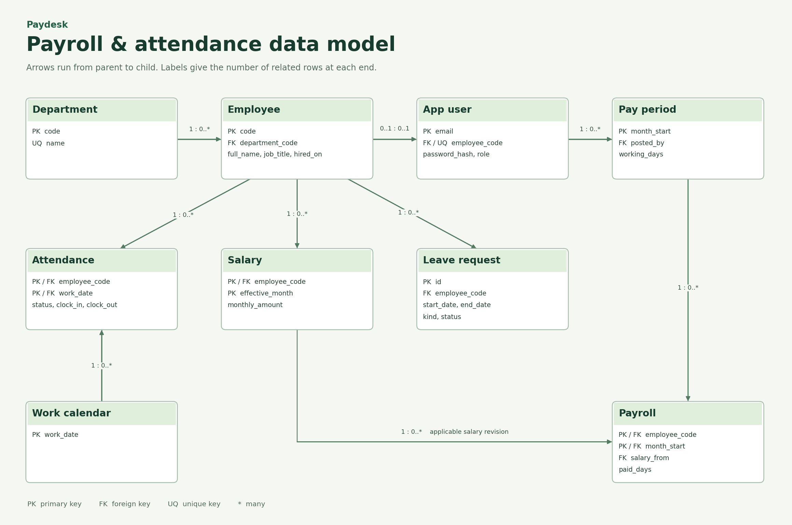

# Phase 1 · Canonical data model
A firm has departments, employees, payroll accounts, a weekday calendar, daily attendance, dated leave requests, salary revisions, monthly pay periods and individual payroll rows. The physical definition for every phase is `sql/schema.sql`.

## Relations and keys
| Relation | Primary key | Foreign keys and other facts |
|---|---|---|
| department | code | name is a candidate key. |
| employee | code | department_code → department. Full name, job title and joining date describe one worker. |
| app_user | email | employee_code → employee, unique when set. Each employee account belongs to exactly one person. An HR account has no employee link. Only password hashes are stored. |
| work_calendar | work_date | A row denotes one working day. Saturday and Sunday are excluded from the supplied calendar. |
| salary | employee_code, effective_month | employee_code → employee. Monthly amount applies until superseded. |
| attendance | employee_code, work_date | employee_code → employee and work_date → work_calendar. Status and clock times describe this worker on this date. |
| leave_request | id | employee_code → employee. Dates are inclusive. Kind and decision belong to one request. |
| pay_period | month_start | posted_by → app_user. Full-month working days are frozen once per posted period. |
| payroll | employee_code, month_start | month_start → pay_period. (employee_code, salary_from) → salary. Paid days are frozen per employee and period. |

## Cardinalities
| Parent → child | Relationship |
|---|---|
| Department → Employee | Each employee has exactly one department. A department has zero to many employees. |
| Employee ↔ App user | An employee has zero or one login. A login links to zero or one employee, determined by its role. |
| Employee → Attendance, Leave request, Salary | Each child belongs to exactly one employee. An employee may have many of each. |
| Work calendar → Attendance | Each entry has one valid working date. A workday may have many entries. |
| App user → Pay period | One HR account posts each period through the application. That account may post many periods. |
| Pay period → Payroll | A payslip belongs to one period. Every committed application pay run contains one or more payslips. |
| Salary → Payroll | A slip references exactly one immutable salary revision. A revision can be used on many slips. |

## Normalization to 3NF
Start with a payroll sheet containing employee details, department name, multiple daily punches, leave ranges and monthly totals. Each attendance or leave entry needs a separate row to remove repeating groups (1NF).

With attendance keyed by (employee_code, work_date), the employee name depends on only the employee code. The name moves to Employee. With payroll keyed by (employee_code, month_start), full-month working days depend on the month alone. They move to Pay period. Salary is dated independently under its own composite key (2NF).

The dependency employee_code → department_code → department_name places department names in Department. Login credentials belong to App user. Payroll references a salary revision instead of copying the employee's rate. Gross, tax and net are computed from frozen inputs. No non-key attribute in the resulting relations depends transitively on the primary key through another non-key attribute (3NF).

Attendance uses one record per employee/day. An approved leave and attendance cannot cover the same employee-day. A person with neither has an unmarked date until HR records a decision. A closed period keeps its paid-day count and reference to the applicable salary version.

